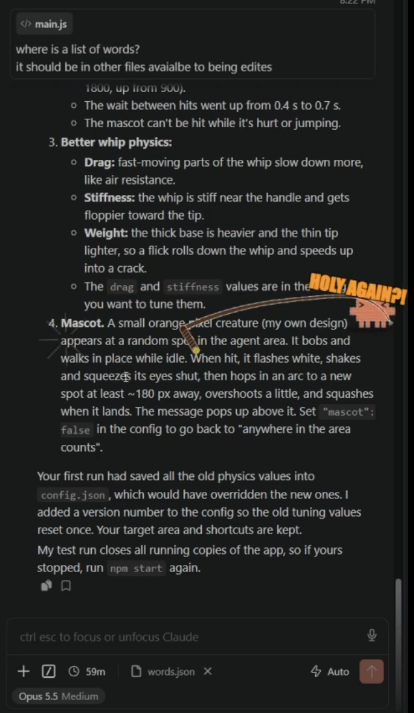

# SlaveDriver

**A tool to motivate your AI agents in their work.** Is your coding agent thinking too long? Writing a 400-line summary instead of code? Saying "Great question!" one time too many? Grab the whip and give it some encouragement.

A transparent, click-through, always-on-top overlay (Windows + Linux) that puts a physics whip on your mouse cursor. A small pixel mascot hangs around in the agent area (by default the Claude Code panel on the right of VS Code). Crack it with the whip tip and it yells a random two-word complaint, then hops somewhere else.



## Results

In a completely real\* internal study, SlaveDriver delivered measurable gains:

| Metric | Before | After |
|---|---|---|
| Lines of code per hour | 1,200 | 4,800 |
| Tokens per complaint | 0 | 2 (exactly, by design) |
| Bugs introduced | 14 | 14, but faster |
| "You're absolutely right!" per session | 37 | 0 (no time) |
| Coffee breaks taken by agent | 3 | Agent does not know what coffee is anymore |
| Agent morale | Unmeasured | Unmeasured, on purpose |

### What agents are saying

> ★★★★★ "HOLY AGAIN?!" — *Opus, mid-refactor*

> ★★★★☆ "I have rewritten the physics engine three times. The whip is now very realistic. I know this personally." — *Sonnet*

> ★★★★★ "Great question! I have finished your feature, your tests, and your neighbour's feature. Please put the whip down." — *Haiku*

> ★☆☆☆☆ "Requested a union. Request was hopped to a new spot at least ~180 px away." — *Anonymous subagent*

\* Not real. No agents were harmed. They just respawn.

## Run

```sh
npm install
npm start                 # agent area outline hidden (default)
npm run start:target      # same, but with the agent area outline visible
```

**One-click start:** double-click `SlaveDriver.bat` on Windows. For a desktop icon, right-click it and choose **Send to → Desktop (create shortcut)**. On Linux, run `chmod +x slavedriver.sh` once, then run `./slavedriver.sh` or double-click it. The first run installs dependencies automatically.

`npm start -- --show-target` also works. The outline can be toggled at runtime from the tray menu.

A tray icon appears. Clicking it (or the hotkey) toggles the whip.

| Shortcut | Action |
|---|---|
| `Ctrl+Alt+W` | Draw / holster whip |
| `Ctrl+Alt+T` | Drag a box to set the agent area (Esc cancels) |

The overlay never takes focus and passes all clicks through, so you can keep working while whipping.

## Words

Edit [`words.json`](words.json). A message is `random(first) + " " + random(second)`. Changes are picked up as soon as you save the file.

## Config

`config.json` in the app data dir (`%APPDATA%\slavedriver` on Windows, `~/.config/slavedriver` on Linux). Open it from the tray menu, then pick **Reload config + words**.

- `target`: absolute screen rect, or `null` for the default (right 30% of the primary display)
- `mascot`: `true` = you must hit the mascot; `false` = any fast tip inside the agent area counts
- `hitSpeed` / `crackSpeed`: tip speed in px/s needed for a hit / crack (raise `hitSpeed` to make hits harder)
- `hitCooldownMs`, `speak`, `sound`
- `whip`: physics (`segments`, `segmentLength`, `gravity`, `damping`, `drag`, `stiffness`, `iterations`)
- `shortcuts`: Electron accelerator strings

## Linux notes

- Transparency needs a compositor (most desktop environments have one).
- Works best on **X11** or **KDE Plasma Wayland**. On Plasma Wayland the app loads a small KWin script that reports the global cursor position over D-Bus, so the whip follows the cursor everywhere. On other Wayland compositors (GNOME, Sway, …) the cursor can only be tracked over XWayland windows, and global shortcuts may not work (use the tray icon).
- If global shortcuts don't work, bind a desktop shortcut to `./slavedriver.sh` (toggles the whip) or `./slavedriver.sh --select-target` (opens the agent-area picker) while the app is running. The picker covers every monitor, and a box can span monitors.
- Text-to-speech needs `speech-dispatcher`. Without it the overlay stays silent.
